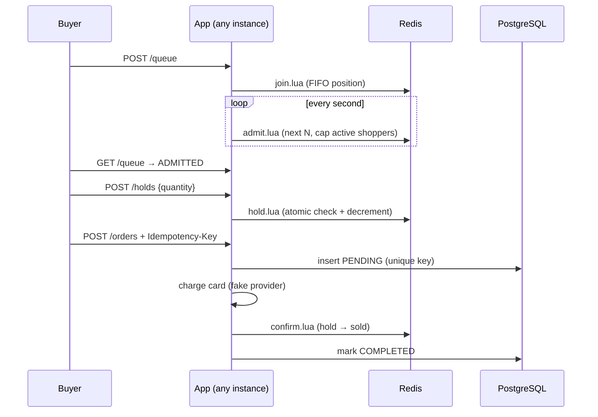

# High-Demand Ticket Drop with Virtual Waiting Room

A backend for selling a fixed number of seats to a crowd that arrives all at once, the way
concert or sneaker drops work, **without overselling, double-charging or melting down**.

Java 21 · Spring Boot 3.5 · Redis (Lua scripts) · PostgreSQL · Docker Compose · k6 · Testcontainers

## The problems and how each is solved

| Problem in a drop | Design |
|---|---|
| 50,000 people arrive in the same minute | **Virtual waiting room**: FIFO queue (Redis sorted set ordered by an atomic counter). A scheduler admits a fixed number of buyers per tick and caps how many shop at once. |
| Two buyers grab the last seat at the same moment | **Atomic holds**: the "enough seats left?" check and the decrement run in one Redis Lua script, so the check-then-act race cannot happen, even across app instances. |
| Buyers sit on seats they never pay for | **Time-boxed holds** (5 min). Expired holds return to sale on the next tick. |
| One buyer takes everything | **Per-buyer limit** (4 seats) enforced in the same atomic script. |
| Double-clicks and client retries | **Idempotent checkout**: the `Idempotency-Key` is the orders table's primary key. The first request claims it; duplicates get the original result or `409 in progress`. One charge per key, guaranteed by the database. |
| The hold expires while the card is being charged | **Compensation**: confirm fails, the charge is refunded, and the buyer gets `410 Gone`. |
| Bots hammering the join endpoint | **Token-bucket rate limiter** per buyer (burst 5, then 1/s) returning `429` with `Retry-After`. |

Invariant checked everywhere: `available + held + sold == capacity`, and `sold <= capacity`.



## API

| Method | Path | Result |
|---|---|---|
| POST | `/events/drop-2026/queue` | `202` your place in line, `429` rate limited |
| GET | `/events/drop-2026/queue` | `QUEUED` (people ahead) or `ADMITTED` (until when) |
| POST | `/events/drop-2026/holds` `{"quantity":2}` | `201` hold id and expiry, `403` not admitted yet, `409` sold out, `422` over limit |
| POST | `/events/drop-2026/orders` `{"holdId":"…"}` + `Idempotency-Key` | `201` order, `200` replay, `402` declined, `409` in progress, `410` hold expired |
| GET | `/events/drop-2026/stats` | capacity, available, held, sold, queue length, active shoppers |
| POST | `/admin/chaos` `{"declineRate":0.1,"latencyMs":200}` | failure injection for the fake payment provider |

The buyer is identified by an `X-User-Id` header to keep the demo self-contained; a real system
would use an authenticated session.

## Run it

```bash
mvn -B verify              # unit, contract and API tests
mvn spring-boot:run        # one instance, in-memory store, H2 database, on :8080
```

Try the flow:

```bash
curl -X POST localhost:8080/events/drop-2026/queue -H "X-User-Id: ada"
curl localhost:8080/events/drop-2026/queue -H "X-User-Id: ada"            # ADMITTED within a second
curl -X POST localhost:8080/events/drop-2026/holds -H "X-User-Id: ada" -H "Content-Type: application/json" -d '{"quantity":2}'
curl -X POST localhost:8080/events/drop-2026/orders -H "X-User-Id: ada" -H "Idempotency-Key: ada-order-0001" \
     -H "Content-Type: application/json" -d '{"holdId":"<holdId from above>"}'
```

### Distributed: 2 instances, Redis, PostgreSQL

```bash
docker compose up --build              # nginx on :8080 load-balances two app instances
k6 run load/drop.js                    # 1,000 buyers at once
k6 run -e BUYERS=2000 -e DECLINE=0.1 -e PAY_LATENCY_MS=300 load/drop.js   # with failures injected
```

No local k6? `docker run --rm --network host -v "$PWD/load:/load" grafana/k6:0.54.0 run /load/drop.js`
(Linux; on macOS add `-e BASE_URL=http://host.docker.internal:8080`).

The load test ends by reading `/stats` and **fails the run** if seats were oversold or don't add up.

## Tests

- **Contract tests**: the same test classes run against the in-memory and the Redis
  implementations (Redis via Testcontainers, skipped when Docker is off). They include 400
  threads racing for 100 seats: exactly 100 holds every time.
- **Checkout**: 20 concurrent submits with one idempotency key produce 1 order and 1 charge;
  a hold expiring mid-payment triggers a refund; a decline keeps the hold.
- **API**: the full buyer flow over HTTP, rate limiting and input validation.
- **CI**: `mvn verify`, then the whole Docker stack under a 600-buyer k6 run with 10% of
  payments declined.

## Layout

| Package | What it does |
|---|---|
| `core` | Domain and use cases, plain Java (no Spring) |
| `memory` | Single-instance store and the fake payment provider |
| `redis` | Redis store; Lua scripts in `src/main/resources/scripts` |
| `store` | Orders in H2 or PostgreSQL via JDBC |
| `web` | REST API and failure-injection endpoint |

## What I would add for production

Authentication, a real payment provider with webhooks, an outbox for order events, Redis
Sentinel or Cluster, and metrics dashboards for queue length, admit rate and hold expiry.

## License

MIT
